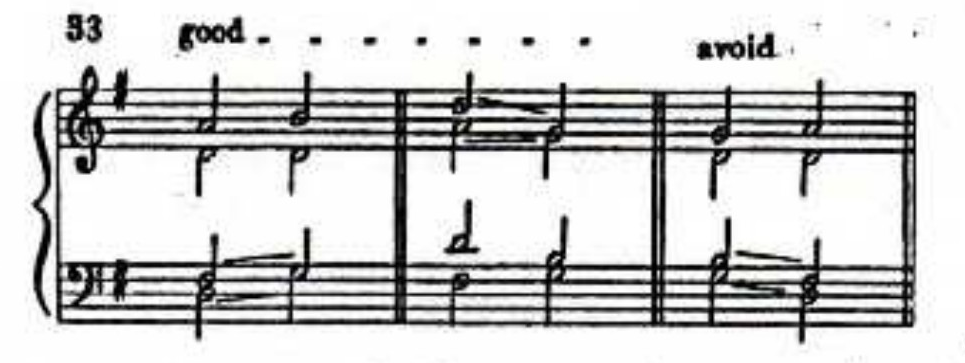

# Memahami skripsi v5

Bahan belajar untuk Vincent, disusun 13 Oktober 2026 dari naskah v5 dan catatan sumber proyek. Gunakan bersama BAB I-III dan halaman Strube yang disebut. Contoh hitung yang diberi label ilustrasi adalah latihan, bukan hasil generasi AI.

## Penelitian yang akan kamu kerjakan

Kamu memberi melodi sopran kepada DeepBach dan Coconet, lalu memeriksa alto, tenor, dan bas yang dihasilkan. Pertanyaannya adalah bagaimana gerak suara itu sesuai dengan Strube setelah syarat dan pengecualiannya diperhatikan, serta bagaimana profil kedua sistem berbeda pada kasus yang sama.

Sopran tetap menjadi bagian yang berhubungan dengan suara lain. Kamu membaca garis alto, tenor, dan bas secara horizontal, kemudian memeriksa hubungan antarsuara pada perpindahan dan keadaan tertentu. Hasilnya berupa catatan kejadian, keputusan musikal, contoh partitur, dan ringkasan per kriteria.

Contoh penjelasan yang dapat kamu latih:

> Saya meneliti gerak suara pada harmonisasi DeepBach dan Coconet untuk satu melodi dalam konteks chorale Strube. Soprannya sama dan dipertahankan, sedangkan tiga suara bawah dihasilkan model. Saya memakai kaidah Strube bersama syarat dan pengecualiannya. Program membantu mencatat pola, lalu saya memeriksa partitur untuk menentukan keputusan. Saya membandingkan profil kedua sistem secara deskriptif pada kasus itu.

Ucapkan kembali dengan bahasamu. Sertakan satu contoh aturan dan alasan penerimaannya, agar penjelasanmu tidak berhenti pada istilah metode.

## Apa yang berubah dari rancangan sebelumnya

| Rancangan 8-9 Oktober | V5 yang sekarang |
| --- | --- |
| Empat puluh melodi Bach dari korpus | Satu kasus dari konteks chorale Strube |
| Pertanyaan khusus zona fermata | Fermata menjadi metadata dan konteks kadens |
| Lima hitungan program sebagai ukuran utama | Kandidat program dibaca melalui syarat sumber; gerak melodis ikut diperiksa |
| Acuan disebut harmonisasi asli Bach | Acuan adalah harmonisasi cetak; identitas dan penyusunnya perlu dibuktikan untuk klaim tentang Bach |
| Uji berpasangan lintas melodi dan perencanaan daya | Analisis partitur dan perbandingan deskriptif pada satu kasus |

Rencana awal sekarang adalah 20 percobaan per model. Angka itu menentukan beban pemeriksaan, bukan jumlah melodi atau jaminan daya statistik. Jumlah final dan pilihan dua model masih perlu disepakati dengan pembimbing.

## Strube sebagai landasan, dari teori sampai keputusan

### Fungsi akor dan gerak suara

Strube menekankan fungsi akor dalam lingkungannya pada Preface. Pada halaman 6, ia menyebut trinada I, IV, dan V sebagai tonika, subdominan, dan dominan, lalu membahas penulisan empat suara.

Sebagai contoh konseptual dalam C mayor, akor C-E-G adalah tonika, F-A-C adalah subdominan, dan G-B-D adalah dominan. Contoh ini menjelaskan istilah fungsi; ini bukan penetapan akor pada MODEL 285. Saat membaca suatu nada, fungsi membantu menentukan apakah nada itu bagian akor, hiasan, atau nada yang memerlukan resolusi.

Gerak suara menjelaskan bagaimana tiap suara berpindah dan bagaimana perpindahan itu berhubungan dengan suara lain. Akor memberi konteks untuk keputusan tersebut. Penelitian tetap berpusat pada gerak suara, dengan analisis akor sejauh diperlukan untuk menilainya.

### Tiga tingkat yang perlu kamu bedakan

| Tingkat | Isi pada v5 | Contoh |
| --- | --- | --- |
| Kerangka umum atau grand theory | Teori harmoni Strube tentang fungsi akor dan penulisan empat suara | Peran tonika, subdominan, dominan serta hubungan garis melodis dengan harmoni |
| Kaidah dan kondisi sumber | Uraian Strube, termasuk tahap, contoh dan pengecualian | Tumpang tindih dengan satu suara melangkah pada hlm. 12-13 |
| Definisi operasional peneliti | Cara memilih, mencatat dan merangkum kejadian | Pasangan suara, waktu transisi, episode, status keputusan dan penyebut |

Susunan tingkat tersebut dibuat untuk penelitian ini. Kamu tidak mengatribusikan pembagian grand theory, kaidah, dan definisi operasional kepada Strube. Dasar musikalnya tetap bisa ditelusuri ke buku.

### Mengapa bab dan tahapnya dibaca

Strube mengajar materi bertahap. Pada halaman 45, kuint antara IV dan II disebut tidak berbahaya tetapi masih diminta dihindari untuk sementara. Pada halaman 174, persilangan suara bawah pada chorale dapat diterima sesekali apabila memperbaiki gerak suara dan tidak melampaui sopran.

Materi lanjut memperluas pilihan dengan syarat tertentu. Sebelum memutuskan suatu kejadian, cari aturan yang berlaku, kondisi yang disebut, dan apakah contoh yang kamu periksa memenuhi kondisi itu.

Teori pendukung punya tugas berbeda. Briot, Hadjeres, dan Pachet membantu menggambarkan perbedaan sistem. Pearce, Meredith, dan Wiggins membantu menetapkan tujuan evaluasi. Huron membantu menjelaskan keterpisahan suara secara perseptual. Dasar penerimaan atau penyimpangan dalam penelitian ini tetap Strube. Persepsi pendengar tidak diukur.

## DeepBach dan Coconet: apa yang perlu kamu pahami

Kedua model belajar pola dari data musik simbolik. Jaringan menyesuaikan parameter selama pelatihan, kemudian memakai peluang yang dipelajari untuk mengisi bagian musik. Penjelasan ini mengikuti tugas komputasional dalam makalah model; tidak membutuhkan klaim bahwa model dilatih persis seperti otak manusia.

| Aspek | DeepBach | Coconet |
| --- | --- | --- |
| Representasi | Deretan nada per suara dan simbol penahan, dengan metadata | Piano roll: tinggi nada yang berbunyi pada tiap langkah waktu dan suara |
| Jaringan | Memakai komponen rekuren LSTM | Memakai jaringan konvolusional |
| Generasi | Pseudo-Gibbs sampling memperbarui nada menurut konteks | Pelengkapan bagian kosong, termasuk blocked Gibbs sampling |
| Tugas penelitian | Sopran tetap; alto, tenor, bas diisi | Sopran tetap; alto, tenor, bas diisi |
| Batas informasi | Periksa konversi dan metadata pada implementasi yang dipakai | Ejaan asli dan nada ulang versus nada ditahan tidak tersedia dalam piano roll |

LSTM pada DeepBach tidak berarti generasinya hanya menulis dari kiri ke kanan. Prosedur sampling memperbarui pilihan dengan konteks musik yang tersedia. Menjalankan model berulang dapat menghasilkan jawaban berbeda, sehingga satu keluaran belum memperlihatkan variasi generator.

### Apa data latihnya?

Makalah asli DeepBach melaporkan 352 chorale setelah penyaringan, diperluas melalui transposisi menjadi 2.503 contoh, dengan pembagian 80 persen pelatihan dan 20 persen validasi (Hadjeres et al., 2017, hlm. 1366). Angka ini adalah riwayat implementasi dalam makalah. Penelitian merencanakan implementasi PyTorch; riwayat bobot yang benar-benar digunakan perlu diperiksa tersendiri.

Makalah Coconet menjelaskan pembelajaran dan pelengkapan chorale Bach empat suara (Huang et al., 2017, bagian 3 dan 6). Artikel Bach Doodle menyebut 382 chorale dalam gabungan data pelatihan dan validasi yang dianalisis (Huang et al., 2019, hlm. 798). Jangan mengubah angka gabungan itu menjadi jumlah pelatihan setiap checkpoint.

Checkpoint adalah bobot hasil pelatihan yang akan dijalankan. Nama model, versi kode, dan checkpoint adalah identitas yang berbeda; masing-masing dicatat supaya konfigurasi yang menghasilkan suatu keluaran bisa ditelusuri.

### Mengapa hasilnya dapat diperiksa dengan Strube?

Hubungannya ada pada lingkungan musik dan tugas harmonisasi empat suara. Buku Strube menjadi pedoman eksternal yang relevan untuk membaca keluaran. Model tidak harus memakai buku itu sebagai bahan latih.

Kesamaan domain belum merupakan korelasi statistik yang diukur. Kita juga belum mengetahui apakah MODEL 285 pernah masuk data latih checkpoint. Penelitian karena itu menilai keluaran pada kasus yang dipilih, tanpa menyebut kasus tersebut pasti baru bagi model.

Perbandingan DeepBach dan Coconet mencakup gabungan data, representasi, jaringan, bobot dan sampling. Jika profilnya berbeda, kamu menjelaskan perbedaan sistem yang diuji. Penelitian ini tidak mengisolasi pengaruh CNN dibanding LSTM.

## Kasus, acuan dan bahan yang masih diperlukan

MODEL no. 285 pada halaman 174-176 memuat lima sistem harmonisasi empat suara. EXERCISES no. 286 dimulai sesudah MODEL dan memuat melodi latihan. MODEL menyediakan contoh pilihan harmonisasi pada sumber tersebut; ia tidak menjadi kunci semua latihan.

Sopran MODEL menjadi calon masukan, sedangkan tiga suara bawah cetak menjadi acuan setelah pembacaan lengkap diverifikasi. Perbedaan nada keluaran terhadap acuan belum berarti menyimpang. Pilihan itu dinilai melalui syarat kaidah, seperti pilihan lainnya.

Scan sekarang belum cukup untuk mengunci keseluruhan kasus: cap menutupi bagian bas awal dan durasi sopran akhir masih perlu sumber lebih jelas. Pengetikan yang berhasil dibaca program belum membuktikan kesesuaian dengan sumber. Jika sumber tetap tidak dapat dipastikan, kasus lain yang utuh dapat dipilih pada konteks sama sebelum hasil model diketahui.

Saat menyiapkan bahan, simpan edisi, halaman cetak, halaman PDF, gambar sistem, transkripsi asli dan catatan pemeriksaan. Identitas karya serta penyusun harmonisasi cetak belum dibuktikan sebagai suatu harmonisasi asli Bach.

## Kriteria: apa yang dibaca dan mengapa

Peta proyek memuat 14 keluarga yang relevan dengan fokus ini. Lima keluarga sudah memiliki pemeriksa awal pada instrumen lama. Gerak melodis A/T/B masuk pembacaan wajib; interval tersembunyi menjadi profil pendamping.

| Keluarga | Pertanyaan saat membaca | Sumber Strube |
| --- | --- | --- |
| Kuint sejajar | Suara mana bergerak? Bagaimana interval sebelum/sesudah, fungsi, dan nada nonakornya? | 9, 12, 34-35, 45, 83, 96 |
| Oktaf/unisono sejajar | Apakah kedua suara bergerak? Ada penundaan atau nada bantu? | 9, 12, 23, 83, 96 |
| Tumpang tindih | Apakah suara melewati nada sebelumnya pada suara tetangga? Ada suara yang melangkah? | 12-13 |
| Jarak suara atas | Bagaimana interval, lama keadaan dan kelonggaran sesekali/sementara? | 7, 20 |
| Persilangan | Apakah melampaui sopran? Jika suara bawah, apa alasan penerimaannya? | 174 |
| Gerak melodis | Bagaimana langkah, lompatan, arah dan kelanjutan bas? | 7, 13, 20, 23 |
| Kuint/oktaf tersembunyi | Bagaimana pendekatan ke interval tujuan dan kondisi sumbernya? | 12, 109 |

Wilayah suara, nada penuntun, septim, suspensi/nada bantu, penggandaan, bahan akor/modulasi, dan kadens memberi konteks. Menjadikan semua keluarga sebagai hitungan penalti tersendiri akan memperluas pertanyaan dan kebutuhan anotasi.

Beberapa keputusan perlu kamu ingat:

- Jarak lebih dari 12 semiton membantu menemukan kandidat. Syarat halaman 20 tetap memerlukan pembacaan durasi dan alur, termasuk episode A-T selebar tepat satu oktaf.
- Persilangan suara bawah tidak diterima secara otomatis. Strube memberikan syarat sesekali dan perbaikan gerak.
- Kuint tidak murni menuju kuint murni dapat terlewat oleh detektor P5-P5 lama. Bagian tanpa tanda juga diperiksa.
- Penundaan kuint dan oktaf tidak mendapat kelonggaran yang sama pada halaman 83.
- Nada bantu pada halaman 96 tidak boleh dipakai untuk menyamarkan paralel struktural.

## Membaca contoh nyata: Fig. 33

Gambar memuat dua panel good dan satu avoid. Dua transkripsi proyek memakai good pertama dan avoid; panel tengah belum termasuk pemeriksaan itu. Huruf dan angka di bawah menyatakan nama nada serta nomor oktaf pada tinggi nada bunyi.

| Suara | Good pertama | Avoid |
| --- | --- | --- |
| Sopran | A4 ke B4 | G4 ke A4 |
| Alto | D4 ke D4 | D4 ke D4 |
| Tenor | F#3 ke G3 | B3 ke F#3 |
| Bas | D3 ke G3 | G3 ke D3 |

Pada good pertama, bas tiba di G3, lebih tinggi daripada F#3 tenor sebelumnya. Ada pola tumpang tindih, tetapi tenor bergerak satu semiton ke G3. Contoh buku menerima kondisi satu suara melangkah tersebut.

Pada avoid, tenor tiba di F#3, lebih rendah daripada G3 bas sebelumnya. Tenor dan bas sama-sama turun lima semiton, masing-masing dari B3 ke F#3 dan dari G3 ke D3. Keduanya melompat, sehingga syarat gerak melangkah tidak terpenuhi pada contoh yang dihindari.

Tumpang tindih membandingkan posisi sekarang dengan nada sebelumnya pada suara tetangga. Persilangan membandingkan urutan tinggi nada pada saat yang sama. Pada tujuan panel avoid, F#3 tenor masih lebih tinggi daripada D3 bas; jadi pola yang dibaca di sini adalah tumpang tindih.

Pemeriksa v2 memberi hitungan overlap 0 pada good pertama dan 1 pada avoid, sesuai label sumber pada dua transkripsi tersebut. Ini pemeriksaan dua contoh satu kondisi; bukan bukti bahwa instrumen kontekstual v5 sudah valid seluruhnya. Peneliti masih perlu memastikan transkripsi terhadap sumber.

Latihan singkat: tutup paragraf penjelasan, lalu tunjukkan nada sebelumnya yang dilampaui, suara yang bergerak, dan alasan keputusan pada kedua panel.

## Dari kandidat ke keputusan musikal

Program membantu menemukan pola. Kamu membaca kondisi yang menentukan statusnya dan mencatat alasan serta halaman sumber.

| Status | Dasar keputusan |
| --- | --- |
| Menyimpang terkonfirmasi | Kaidah berlaku dan pengecualian yang relevan tidak dapat diterapkan |
| Diterima menurut syarat/pengecualian | Ada kondisi sumber yang mendukung penerimaan |
| Belum dapat diputuskan | Ejaan, fungsi, informasi atau dasar penafsiran belum cukup |

Bagian yang belum diputuskan tetap dilaporkan. Jumlah penyimpangan kecil tidak berarti kepatuhan tinggi apabila banyak keputusan belum pasti.

Ejaan nada dapat memengaruhi keputusan. Sebagai ilustrasi interval, C#4 ke E4 dan Db4 ke E4 mempunyai jarak tinggi nada yang sama, tiga semiton. Ejaannya membentuk terts kecil pada yang pertama dan sekon berlebih pada yang kedua. Nomor MIDI saja belum membedakan keduanya. Ilustrasi ini bukan transkripsi MODEL atau keluaran AI.

Satu baris analisis perlu memuat keluaran/sumber, kriteria, suara atau pasangan, lokasi, nada dan interval, konteks, status, halaman dasar keputusan, serta alasan. Ini bentuk ringkas untuk mencatat contoh buku:

| Isian | Contoh dari Fig. 33 avoid |
| --- | --- |
| Bahan | Contoh sumber, bukan harmonisasi AI |
| Pasangan | Tenor-bas |
| Nada | T: B3 ke F#3; B: G3 ke D3 |
| Pola | Tumpang tindih terhadap posisi sebelumnya |
| Alasan | Kedua suara melompat lima semiton; syarat melangkah tidak terpenuhi |
| Dasar | Label avoid dan uraian Strube hlm. 12-13 |

## Unit analisis dan latihan hitung

### Satu kasus, keluaran berulang, banyak kejadian

Kasusnya satu melodi. Percobaan menghasilkan harmonisasi atau kegagalan. Satu harmonisasi memuat banyak transisi dan episode yang berbagi konteks. Kamu melaporkan jumlah pada tiap tingkat itu.

Generasi baru dari inisialisasi baru dapat memperlihatkan variasi pada melodi tetap. Kesimpulan lintas melodi membutuhkan kasus tambahan dan desain pemilihan yang sesuai. Nomor percobaan sama pada dua model juga tidak membuat keduanya pasangan acak yang setara.

### Ilustrasi A: penyimpangan dan ketidakpastian

Anggap satu keluaran memiliki 60 kesempatan yang layak untuk satu kriteria. Tiga kesempatan dinilai menyimpang, dua belum dapat diputuskan. Angka ini dibuat untuk latihan.

D adalah jumlah penyimpangan terkonfirmasi, U jumlah kandidat belum dapat diputuskan, dan O jumlah kesempatan yang layak.

| Ukuran | Perhitungan | Hasil |
| --- | --- | --- |
| $R = D/O$ | 3/60 | 0,05 atau 5 persen |
| $Q = U/O$ | 2/60 | Sekitar 0,0333 atau 3,33 persen |

Laporkan 3 penyimpangan dari 60 kesempatan dan 2 keputusan belum pasti dari 60 kesempatan. Nilai Q tidak diubah menjadi nol. Kesempatan yang memenuhi kaidah tanpa pengecualian tidak semuanya menjadi kandidat bertanda, sehingga R dan Q tidak otomatis menjumlah menjadi 100 persen.

Jika O nol, rasio tidak tersedia. Pola struktural yang melewati nada hias atau suspensi dicatat sebagai rentang analisis tersendiri; penyebut transisi langsung tidak dipakai untuk menghitungnya.

### Ilustrasi B: keluaran layak dan kegagalan

Anggap ada 20 percobaan, 18 keluaran layak dan dua kegagalan. Tujuh keluaran layak memuat pola yang ingin dibahas. Ini juga angka latihan.

Frekuensi pada keluaran layak adalah 7/18, sekitar 38,9 persen. Jumlah percobaan dan kegagalan tetap dilaporkan. Membagi 7 dengan 20 menjawab proporsi terhadap seluruh percobaan; itu penyebut yang berbeda dan harus dinyatakan bila digunakan.

### Ilustrasi C: episode dan durasi

Anggap satu kondisi jarak berlangsung terus selama dua satuan not seperempat. Pada kisi seperenam belas, kondisi itu menempati delapan langkah waktu. Menurut definisi episode yang direncanakan, catat satu episode dengan durasi dua satuan not seperempat.

Delapan posisi waktu tidak otomatis menjadi delapan penyimpangan baru. Status normatifnya masih memerlukan konteks dan syarat sumber. Jika kondisi hilang lalu muncul lagi, ada episode baru.

## Pemeriksaan yang berbeda tugasnya

| Pemeriksaan | Pertanyaan yang dijawab |
| --- | --- |
| Pembacaan ulang MusicXML | Apakah berkas menyimpan apa yang dimasukkan? |
| Pemeriksaan terhadap scan/buku | Apakah nada dan tanda yang dimasukkan sesuai sumber? |
| Uji perangkat lunak | Apakah kode berperilaku sesuai definisi pada kasus uji? |
| Validasi instrumen | Apakah pencatatan dan keputusan mengukur gerak suara yang dimaksud? |
| Pilot | Apakah tugas dan prosedur dapat dijalankan secara teknis? |
| Data utama | Apa yang diperoleh dari percobaan dengan prosedur yang sudah ditetapkan? |

Dua file yang dapat dibaca program bisa saja memuat pengetikan yang keliru. Program yang cocok pada Fig. 33 juga belum tentu menangkap semua pola atau menerapkan semua pengecualian. Karena itu, bagian tanpa tanda dan keputusan konteks ikut diperiksa.

## Menghubungkan BAB I, II dan III

Pertanyaan pertama meminta kesesuaian terhadap Strube. BAB II menyediakan kaidah dan kondisi; BAB III menyediakan cara mencatat kandidat, konteks, keputusan, serta ketidakpastian. Hasil nantinya perlu menampilkan alasan keputusan itu pada partitur.

Pertanyaan kedua meminta perbedaan profil sistem pada kasus sama. BAB III merencanakan statistik deskriptif per keluaran dan model, lokasi berulang, kegagalan, serta variasi. Pembahasan membandingkan gerak dan pilihan musikalnya dalam batas konfigurasi yang diuji.

Urutan kerja yang perlu kamu pahami:

~~~text
Sumber kasus dan transkripsi terverifikasi
  -> kaidah, kondisi dan contoh pemeriksaan
  -> masukan model dan uji coba teknis
  -> protokol serta instrumen dibekukan
  -> percobaan utama dan catatan kegagalan
  -> pemeriksaan kualitas dan kandidat
  -> keputusan musikal dan profil
  -> jawaban kedua pertanyaan pada kasus itu
~~~

Saat ini protokol kasus 4.0 dan instrumen kontekstual 3.0 adalah rencana tertulis. Pipeline yang tersedia masih memakai desain historis 3.0 dan instrumen 2.0. Naskah yang selesai direvisi belum berarti model sudah dijalankan atau data utama sudah tersedia.

## Belajar dalam lima sesi

| Sesi | Bahan dan pekerjaan | Hasil yang kamu buat |
| --- | --- | --- |
| 1 | BAB I dan bagian awal panduan | Penjelasan dua menit: objek, dua pertanyaan, kasus dan batasnya |
| 2 | Strube hlm. 6-13, 20, 23, 45 dan 174 | Catatan satu kaidah dengan tahap, syarat dan pengecualian; penjelasan Fig. 33 |
| 3 | Makalah model dan tabel perbandingan | Tabel tugas, representasi, data dan informasi yang hilang; bedakan model dan checkpoint |
| 4 | BAB III dan tiga latihan hitung | Bedakan kasus, keluaran, kejadian, kesempatan, episode dan penyebut |
| 5 | Lembar latihan bimbingan | Jawaban lisan tanpa membaca; tandai pertanyaan yang masih membutuhkan sumber atau keputusan pembimbing |

Periksa kembali jawabanmu dengan halaman sumber. Catat bacaan yang benar-benar dilakukan dalam reading-notes.csv; kolom pemeriksaan asisten dan bacaan peneliti mempunyai fungsi berbeda.

## Bacaan dan berkas pendamping

- Strube (1928), Preface dan halaman yang disebut dalam panduan. Gunakan [peta kaidah](peta-kaidah-gerak-suara-strube.md) dan konkordansi untuk mencari tahap serta pengecualian.
- Hadjeres, Pachet, dan Nielsen (2017), [DeepBach](https://proceedings.mlr.press/v70/hadjeres17a.html), khususnya bagian 2.
- Huang et al. (2017), [Counterpoint by Convolution](https://archives.ismir.net/ismir2017/paper/000187.pdf), bagian 3 dan 6.
- Huang et al. (2019), Bach Doodle, bagian 6.3, hlm. 798; Yan et al. (2018), penilaian harmonisasi dan rubriknya.
- [Flyvbjerg (2006)](https://arxiv.org/abs/1304.1186) untuk pengetahuan kontekstual studi kasus; [Lazic (2010)](https://link.springer.com/article/10.1186/1471-2202-11-5) untuk pengamatan berulang dan pseudoreplikasi. Penerapannya pada musik adalah penalaran penelitian ini.
- Briot, Hadjeres, dan Pachet (2020), hlm. 11-13; Pearce, Meredith, dan Wiggins (2002); Huron (2001), hlm. 2-5 dan 18-37.
- [Latihan bimbingan v5](latihan-bimbingan-v5.md), [panduan langkah peneliti](researcher-guide.md), dan [lembar arah bimbingan](../supervision/bimbingan-arah-v5.md).

Baca sumber tentang aturan yang akan kamu pakai, lalu catat sebuah keputusan beserta alasan dan halamannya. Gunakan keputusan itu untuk menjelaskan penelitianmu di sesi bimbingan.
